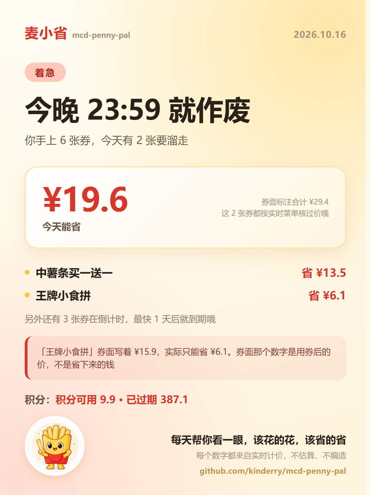

<div align="center">


# 麦小省 · mcd-penny-pal

**一个会主动找你的麦当劳省钱搭子**

券快过期了，它比你先着急；帮你省到钱了，它会忍不住邀功。

基于麦当劳中国官方 MCP（`mcp.mcd.cn`）· 只调只读接口算钱 · 零 Token 就能跑通全链路

</div>

---

## 它替你盯着一件小事

你手机里躺着 6 张券，其中 2 张**今晚 23:59** 就到期了。

你多半不知道。App 也不会主动拦你。

券包只会说「你有一张中薯条买一送一」。它不会告诉你：这张**真能省 ¥13.5**；
而旁边那张「王牌小食拼」券面印着 ¥15.9、看着更香，实际只省 ¥6.1。

麦小省就干三件事：

1. **自己找上门** —— 你还没开口，它先告诉你今天哪张券要没了
2. **算真钱** —— 每张券都拿官方计价接口试算一遍，报的是真省下来的钱，不是券面那个数
3. **说人话** —— 甩给你一张能截图发出去的战报卡片，不是一屏数字

<div align="center">

<br>
<sub>由真实数据生成，1080×1440，可直接发社交平台</sub>
</div>

## 30 秒跑起来（**不需要任何 Token**）

```bash
git clone https://github.com/kinderry/mcd-penny-pal.git
cd mcd-penny-pal

python tools/test_all.py         # 109 项自测，全部跑在真实返回上
python tools/run_briefing.py     # 今日省钱简报
python tools/run_price.py        # 哪张券最值（真实计价）
python tools/run_card.py         # 战报卡片（HTML + PNG）
```

只要 Python 3.11+ 标准库。**没有任何第三方依赖**，不用联网，也不用麦当劳账号。

上面这几条命令读的是 `fixtures/demo/` —— 2026-10-16 对 `mcp.mcd.cn` 的**真实返回**，
只脱敏了账号 ID、收货地址、手机号这些个人信息，券码、门店、价格一个字符都没动。
所以离线跑出来的结果，跟你自己连上账号跑是**逐字一致**的。

`run_briefing.py` 的真实输出长这样：

```
【着急】哎呀，你有 2 张券今晚 23:59 就到期啦！

券包里一共 6 张，今天就没了的是这 2 张（钱都按实时菜单算过，不是券面那个数）：

· 中薯条买一送一（省 ¥13.5）
· 王牌小食拼（省 ¥6.1）

这 2 张加起来能省 ¥19.6，是拿实时菜单算过的哦。

「王牌小食拼」要小小声说一句：券面写着 ¥15.9，实际只能省 ¥6.1 哦。
券面那个数字是用券后的价，不是省下来的钱，不要被它骗到啦。

另外这 3 张也在倒计时哦：明天「巧克力味厚松饼猪柳蛋套餐」、
2 天后「人气麦旋风买一送一」、2 天后「巧克力味厚松饼猪柳蛋套餐」。

积分也要说一句：能用的只剩 9.9 了，已经过期掉 387.1 分。
攒着不用，它是真的会没的哦。

要小省帮你算算今天这一单怎么点最省吗？给个预算，我来比。
```

## 四个能力

### M1 券管家 · Catch

**四路券池合并。** 少查一路，你就少省一笔：

| 券池 | 接口 | 特点 |
|---|---|---|
| 麦麦省待领券 | `available-coupons` → `auto-bind-coupons` | 领取机会，没有有效期 |
| 我的券包 | `query-my-coupons` | **唯一带真实有效期的来源** |
| 当前门店专属券 | `query-store-coupons` | **唯一带 `couponId` / `couponCode` 的来源** |
| 门店定位 | `query-nearby-stores` | 用 `beType` + `searchType`，不是 `address` |

三件事只有踩过才知道：

- **临期预警只能以券包为数据源** —— 另外两路都给不出有效期
- **「已领取」不能再提示「可以领」** —— 领完券后可领池的 `status` 会全部翻转
- **同名券不能按名字去重** —— 实测有两张「巧克力味厚松饼猪柳蛋套餐」，一张 10-17 到期、一张 10-18，去重键必须带上到期时刻

### M2 比价官 · Calc

想知道「怎么点最省」，得走这条**唯一能拿到真实金额**的链路：

```
query-meals          → 当前门店实时菜单（价格主数据源，绝不写死）
query-store-coupons  → couponId / couponCode / 券专属商品编码 ← 钥匙只在这里
calculate-price      → 真实计价，discount 字段就是「省了多少」
```

实测结果（2026-10-16 · 上海吴江路餐厅 · 到店自取）：

| 券 | 原价 | 实付 | **真实省下** | 券面标注 |
|---|---|---|---|---|
| 中薯条买一送一 | ¥27.0 | ¥13.5 | **¥13.5** | ¥13.5 |
| 9.9元中杯冰美式 | ¥19.0 | ¥9.9 | **¥9.1** | ¥9.9 |
| 王牌小食拼 | ¥22.0 | ¥15.9 | **¥6.1** | ¥15.9 ⚠️ |

看最后一行：券面标注 ¥15.9，**实际只省 ¥6.1**。谁按券面价排序，谁就会给你推错券。

### M3 下单员 · Order

`create-order` 下单 → `query-order` 追踪 → `cancel-order` 反悔。
**下单是不可逆动作，门店、餐品、金额必须复述一遍让你确认过，才敢执行。**

### M4 记账本 · Ledger

`order-list` 还原真实消费 + `query-my-account` 看积分（积分是另一种有保质期的钱）。
整单退款不计入消费；样本不足 3 笔时只报单数，不报客单价。

> 说句实话：这次实测账号的 `order-list` 返回 `data: {}`，没有可读的历史订单，
> 所以 M4 只完成了积分侧，消费统计暂时没法用真实数据验证。

## 四条铁律（数字可信的底气）

这不是写在文档里的口号，是**有断言守着的**（`tools/test_card.py` / `test_valuation.py`）：

| 铁律 | 落地方式 |
|---|---|
| **绝不估算价格** | 所有金额必须来自 `calculate-price` / `query-meals` 返回。简报里每个数字都要能在输入里找到出处，测试会往简报里塞一个 `¥999.9` 验证能否被抓出来 |
| **券必须从四路查全** | 四路合并去重，命名规范化后按「券名 + 到期时刻」匹配 |
| **券的价值要能反查** | 门店券里没有的券，价值记 0 并标注「无法估价」。**部分可估时绝不说「这 N 张值多少」** |
| **不诱导消费** | 凑单反而更贵时主动说破，哪怕这意味着这一单不花钱 |

再加两条卡片专属纪律（卡片是要被截图传播的，一个错数字会被几十人当事实转发）：

- **只讲能核到价的券** —— 门店券里没有对应条目的券，卡片上一个数字都不给
- **大数字只算最紧急那一组** —— 把「今天到期」和「T-3 内到期」混着算，会出现「今天到期 2 张」配「4 条清单」的错位

## 踩过的坑（都写进了自测）

解析层要兼容 **4 种互不相同的返回形态**，最容易翻车的是这两种：

- `query-nearby-stores` / `delivery-query-addresses` **从不带 `## Original Response` 标记**，就算成功了也是 JSON 与说明文字混排
- `query-store-coupons` 的前言里有一堆 `## 字段说明` 这样的二级标题，会被 Markdown 解析器**当成券名** —— 真券一条没出来，券池从 6 张虚报成 10 张

还有几个纯业务坑：

- `calculate-price` 返回的单位是**分**（`originalPrice=2700` = ¥27），菜单的 `currentPrice` 是**元字符串**。混用差 100 倍
- 门店券的到期字段叫 `tradeDateTime`，不是 `expireTime`。漏掉它 → 同券去重匹配不上 → 同一张券被算两次（6 张虚报成 9 张）
- 「明天 10:29 到期」不能用 `timedelta.days` 算 —— 当时 10:59，相差 23.5 小时，会被算成 **0 天**，明天的事被报成今天
- `auto-bind-coupons` 报「成功 7 张」，券包实际只到账 6 张。**领券成功 ≠ 进卡包**，引擎必须以券包为准

完整实测口径见 [`docs/MCP_TOOLS.md`](docs/MCP_TOOLS.md)。

## 目录结构

```
mcd-penny-pal/
├── README.md                     本文件
├── MCP_INTEGRATION.md            调了哪些 Tool、调用时序、业务价值
├── CONTEST_DECLARATION.md        参赛声明（官方原文）
├── workbuddy.md                  WorkBuddy 对话上下文
├── mcp-config.example.json       接入配置样例（仅环境变量占位，无真实凭证）
├── fixtures/
│   ├── demo/                     可公开的脱敏返回（离线跑的就是它）
│   └── raw/                      本地未脱敏版，已 gitignore
├── assets/
│   ├── mascot-avatar.png         麦小省形象（已移除商标图形）
│   ├── mascot-card.png           卡片用形象图（480px）
│   └── demo-card.png             战报卡片成品
├── docs/
│   ├── DESIGN.md                 产品设计
│   ├── MCP_TOOLS.md              35 个工具的实测参数与返回形态
│   ├── BRIEFING_SAMPLES.md       简报文案与调性
│   └── CARD.md                   卡片设计与踩坑记录
├── tools/                        可执行入口
│   ├── test_all.py               一键跑完全部自测（109 项）
│   ├── run_briefing.py           → 今日省钱简报
│   ├── run_price.py              → 真实比价报告
│   ├── run_card.py               → 战报卡片（HTML + PNG）
│   ├── smoke.py                  联网冒烟测试 + 落盘真实返回
│   ├── make_demo_fixtures.py     脱敏生成 fixtures/demo
│   ├── scan_pii.py               扫描返回里可能的个人信息
│   ├── replay.py                 离线回放（把调用映射到真实返回）
│   └── fixtures_path.py          统一解析 fixtures 目录
└── skills/mcd-penny-pal/
    ├── SKILL.md                  人格指令 + 能力编排
    └── src/                      核心引擎（**零第三方依赖**）
        ├── mcp_client.py         MCP Streamable HTTP 客户端
        ├── parser.py             四种返回形态解析
        ├── models.py             领域模型
        ├── coupons.py            M1 四路券池合并 + 临期分级
        ├── pricer.py             M2 真实计价
        ├── valuation.py          M1×M2 缝合：券价值核算
        ├── briefing.py           简报渲染
        └── card.py               战报卡片渲染
```

## 接上真实账号

离线跑通之后，想让它读你自己的券，只要两步：

```bash
# 1. 把 Token 放进环境变量（永远不要写进代码或提交）
export MCD_MCP_TOKEN=<你的 Token>

# 2. 跑实时模式
python tools/run_briefing.py --live
python tools/run_card.py --live
```

也可以作为 WorkBuddy 自定义连接器接入，配置样例见 [`mcp-config.example.json`](mcp-config.example.json)，
踩坑记录见 [`MCP_INTEGRATION.md`](MCP_INTEGRATION.md)。

## 合规与免责

- 本项目是**参赛作品，不是麦当劳官方产品**
- **不使用**任何麦当劳商标图形做角色设计（形象里的品牌元素已全部移除）
- **不做**与其他品牌的价格或产品对比
- **不带**"薅垮商家""白嫖"这类调性，不诱导消费
- 仓库里**不含**任何真实 Token、账号 ID、收货地址、手机号
- 所有餐品信息、价格、供应状态以麦当劳官方渠道实时结果为准；本项目输出仅供参考，不构成营养或医疗建议

<div align="center">
<sub>麦当劳程序员节创意开发大赛参赛作品 · 由 <a href="https://github.com/kinderry">@kinderry</a> 独立开发</sub>
</div>
